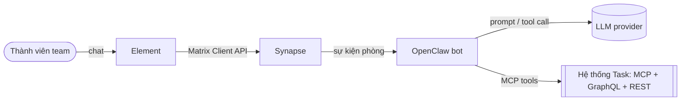
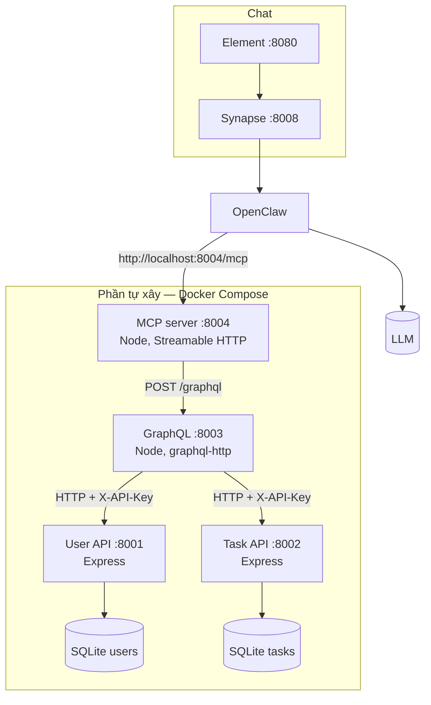
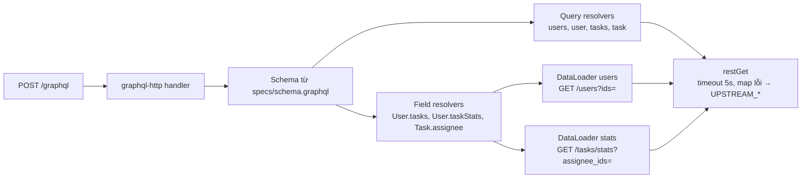
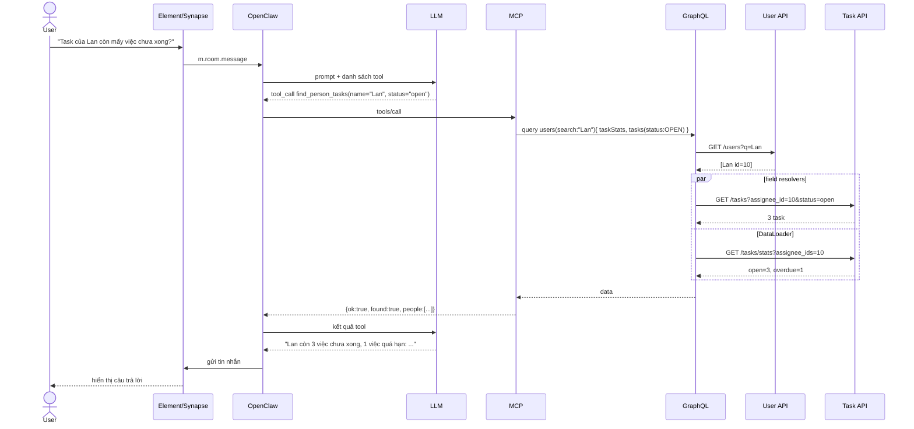
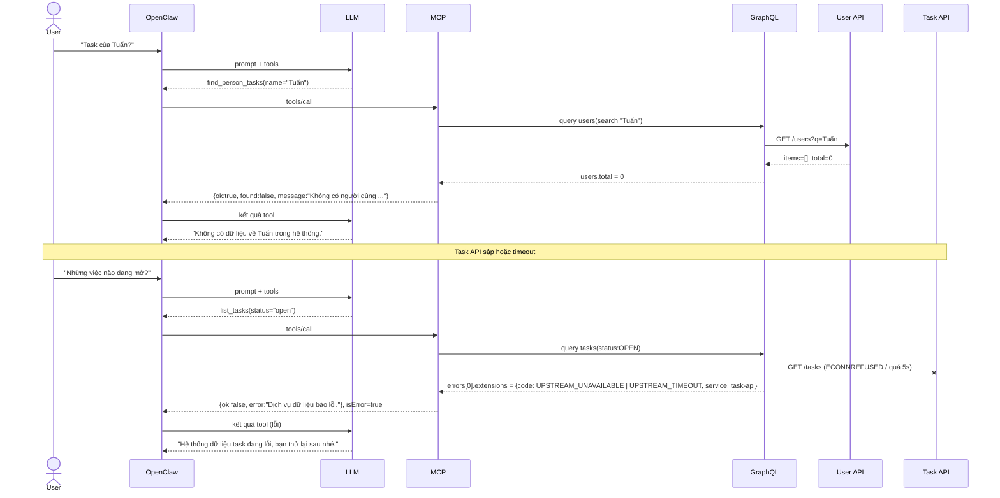
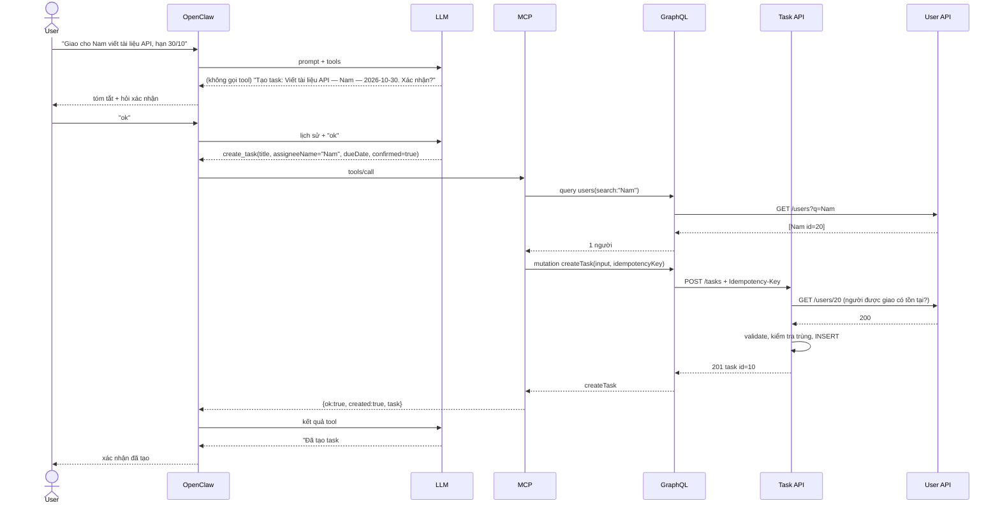
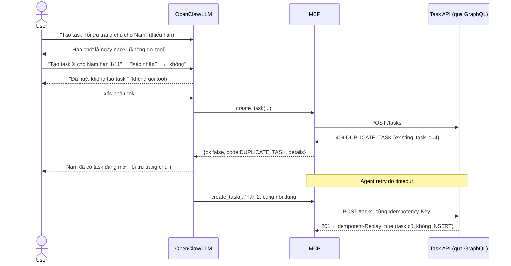
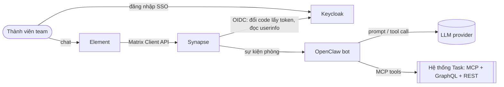
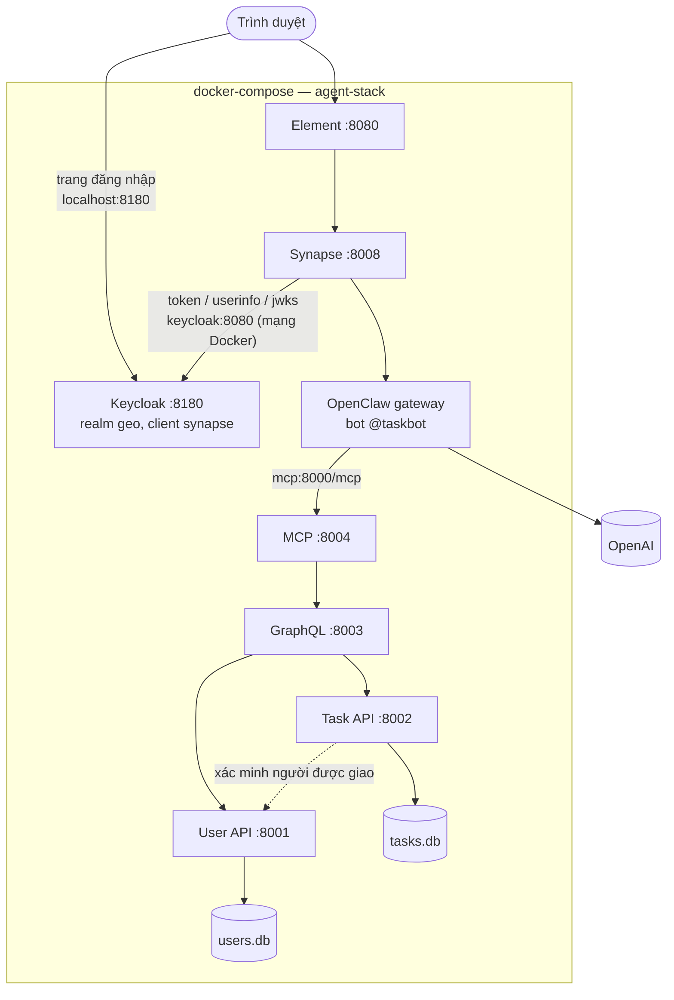
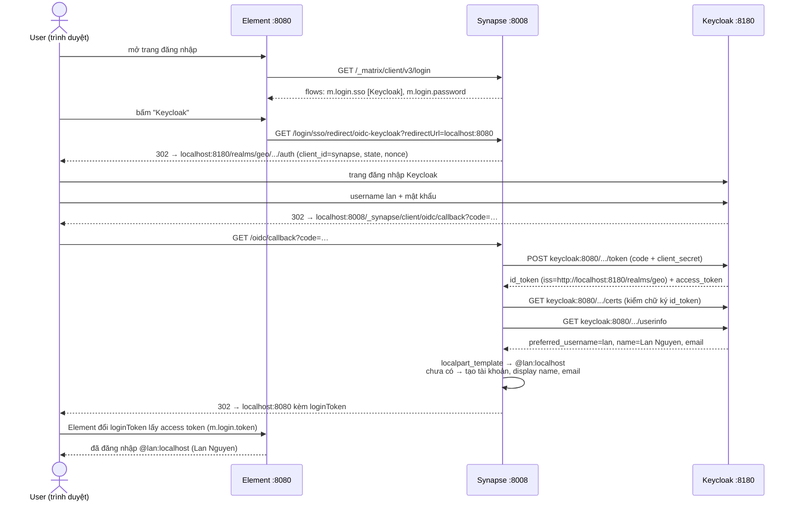

# Báo cáo Bài 1 — REST → OpenAPI → GraphQL → MCP

Diagram viết bằng Mermaid. GitHub, GitLab và VS Code tự render được, hoặc dán vào mermaid.live để xem.

## C1 — System Context



## C2 — Container



## C3 — Component (GraphQL gateway)



## Sequence 1 — "Task của Lan còn mấy việc chưa xong?" (thành công)



## Sequence 2 — Nhánh lỗi



## Kịch bản demo trong Element (chụp ảnh nộp bài)

| # | Câu hỏi | Kỳ vọng |
|---|---|---|
| 1 | Task của Lan còn mấy việc chưa xong? | 3 việc, 1 quá hạn (số lấy từ `taskStats`) |
| 2 | Những việc nào đang mở, ai làm? | Danh sách 6 task kèm tên người. Câu này cần gom cả 2 API |
| 3 | Task của Tuấn? | Không có dữ liệu, không bịa |
| 4 | Task số 999? | Không có task này |
| 5 | (`docker compose stop task-api`) Những việc nào đang mở? | Bot báo hệ thống lỗi |

---

# Bài 2 — Bot tạo dữ liệu qua chat

Luồng ghi: `User → OpenClaw → MCP create_task → GraphQL mutation createTask → REST POST /tasks → SQLite`

## Các lớp bảo vệ

| Rủi ro | Chặn ở đâu | Cách chặn |
|---|---|---|
| Bot ghi khi user chưa đồng ý | Persona + MCP | SOUL.md bắt tóm tắt và hỏi xác nhận. Tham số `confirmed` của tool chỉ nhận `true` (zod `literal(true)`) |
| Bot tự điền thông tin thiếu | Persona + MCP + REST | Persona bắt hỏi lại. Tool bắt buộc đủ 3 trường. REST trả 422 nếu thiếu hoặc sai |
| Giao nhầm người | MCP + REST | MCP tra tên: 0 người → `ASSIGNEE_NOT_FOUND`, nhiều người → `AMBIGUOUS_ASSIGNEE`. REST kiểm tra lại id qua User API |
| Tạo trùng khi agent retry | REST (`Idempotency-Key`) | MCP sinh key từ nội dung + khung 10 phút. Gửi lại cùng key thì REST trả kết quả cũ (`Idempotent-Replay: true`) |
| Tạo trùng do user nhập lại | REST | Task đang mở cùng người, trùng tiêu đề (không phân biệt hoa thường, khoảng trắng) → `409 DUPLICATE_TASK` |
| Dữ liệu sai định dạng | REST | Tiêu đề 3–200 ký tự, ngày phải có thật và không ở quá khứ → `422 VALIDATION_ERROR`, `details` chỉ rõ trường lỗi |

## Sequence — tạo thành công có xác nhận



## Sequence — nhánh lỗi



## Kịch bản demo (chụp ảnh nộp bài)

| # | Tình huống | Câu nhắn mẫu | Kết quả đúng |
|---|---|---|---|
| 1 | Tạo thành công có xác nhận | "Giao cho Nam viết tài liệu API, hạn 2026-10-30" → "ok" | Bot tóm tắt, hỏi xác nhận, rồi báo đã tạo kèm id |
| 2 | User từ chối | "Tạo task Viết test e2e cho Hoa hạn 2026-11-05" → "không" | "Đã huỷ", log MCP **không** có `create_task` |
| 3 | Thiếu thông tin | "Tạo task Review code cho Minh" | Bot hỏi hạn chót, không tự điền |
| 4a | Trùng | "Giao cho Nam việc tối ưu trang chủ hạn 2026-10-30" → "ok" | Bot báo trùng task #4 |
| 4b | Dữ liệu sai | "Tạo task Họp cho Lan hạn 2026-01-01" → "ok" | Bot báo hạn chót ở quá khứ, hỏi lại ngày |

---


# Bài 4 — Tracing với OpenTelemetry + Jaeger

Một lời gọi tool MCP ra đúng **một** trace trên Jaeger, đi qua `mcp → graphql → user-api / task-api → db.query`. Jaeger UI: http://localhost:16686.

## Cách làm (Node thay cho Python trong tài liệu)

| Tài liệu (Python) | Dự án (Node) |
|---|---|
| `pip install opentelemetry-distro opentelemetry-exporter-otlp` + `opentelemetry-bootstrap -a install` | `npm i @opentelemetry/api @opentelemetry/auto-instrumentations-node` |
| `opentelemetry-instrument uvicorn main:app` | `node --import @opentelemetry/auto-instrumentations-node/register index.js` (REST, MCP) · `node --require ./tracing.cjs index.js` (GraphQL, để cấu hình `ignoreTrivialResolveSpans`) |
| `OTEL_*` trong `environment` của Compose | Như tài liệu, khai một lần bằng YAML anchor `x-otel`, mỗi service tự đặt `OTEL_SERVICE_NAME` |
| Auto-instrument FastAPI + HTTPX | Auto-instrument `http` (server), `undici` (`fetch` — tự gắn `traceparent`), `express`, `graphql` |
| `OTEL_PYTHON_LOG_CORRELATION` + `python-json-logger` | `otel.js`: hàm `log()` in JSON, lấy `otelTraceID`/`otelSpanID` từ span đang chạy |
| `tracer.start_as_current_span(...)` | `withSpan()` / `withSpanSync()` trong `otel.js` (lỗi → `setStatus(ERROR)`, span đỏ) |
| Auto-instrument psycopg | `node:sqlite` chưa có instrumentation → bọc mỗi câu SQL trong span `db.query` (`db.system=sqlite`, `db.statement`) |

Biến dùng chung (`docker-compose.yml`):

```yaml
x-otel: &otel
  OTEL_EXPORTER_OTLP_ENDPOINT: http://jaeger:4317
  OTEL_EXPORTER_OTLP_PROTOCOL: grpc
  OTEL_TRACES_EXPORTER: otlp
  OTEL_METRICS_EXPORTER: none
  OTEL_LOGS_EXPORTER: none
  OTEL_NODE_ENABLED_INSTRUMENTATIONS: http,express,graphql,undici
  OTEL_NODE_RESOURCE_DETECTORS: env,host,os,process   # bỏ dò cloud gây cảnh báo khi chạy local
```

## Span thủ công

| Service | Span | Thuộc tính |
|---|---|---|
| MCP | `mcp.tool <tên tool>` cho cả 5 tool | `mcp.tool.name`; tool trả `ok=false` → span ERROR |
| GraphQL | `graphql.resolve <field>` (auto, đã bỏ field tầm thường) | path của field |
| Task API | `validate_task`, `kiem_tra_trung`, `tinh_thong_ke`, `xep_hang` | `task.assignee_id`, `task.duplicate`, `stats.assignee_count`, `ranking.by` |
| User API, Task API | `db.query` mỗi câu SQL | `db.system`, `db.name`, `db.statement` |

Không gắn dữ liệu nhạy cảm (API key, tên người dùng nhập, nội dung task) vào attribute.

## Trace thành công — `find_person_tasks(name="Lan", status="open")`

```
mcp | POST /mcp
  mcp | mcp.tool find_person_tasks
    mcp | POST (fetch → GraphQL, tự gắn traceparent)
      graphql | POST /graphql
        graphql | graphql.parse · graphql.validate
        graphql | query
          graphql | graphql.resolve users
            graphql | GET → user-api | GET /users → db.query × 2
          graphql | graphql.resolve users.items.*.taskStats      ← DataLoader, 1 lời gọi
            graphql | GET → task-api | GET /tasks/stats → tinh_thong_ke → db.query
          graphql | graphql.resolve users.items.*.tasks
            graphql | GET → task-api | GET /tasks → db.query × 2
```

24 span, 4 service, 1 trace id. Trước khi bật `ignoreTrivialResolveSpans` + `mergeItems` trace có 53 span (mỗi field `id`, `title`… một span).

## Trace lỗi — tắt `task-api` rồi gọi lại

```
mcp | mcp.tool find_person_tasks                       ❌ ERROR (tool trả ok=false)
  graphql | graphql.resolve users                       ✓ user-api trả bình thường
  graphql | graphql.resolve users.items.*.taskStats     ❌ ERROR
    graphql | GET → task-api                            ❌ ERROR  (không có span task-api nào)
  graphql | graphql.resolve users.items.*.tasks         ❌ ERROR
    graphql | GET → task-api                            ❌ ERROR
```

Đọc trace: lỗi phát sinh ở lời gọi **GraphQL → Task API**, Task API không nhận được request (không có span phía server). Log GraphQL ghi `ERROR REST GET /tasks thất bại`, MCP trả `UPSTREAM_UNAVAILABLE, service: task-api`. Mất ~8 s mới báo lỗi vì Docker DNS chờ phân giải tên container đã dừng.

## Grep log theo trace id

Trace lỗi ở trên (task-api tắt), trace id `dd03f90e1b3d562ab5fd2ce7956f8677`:

```bash
docker compose logs --no-log-prefix | grep dd03f90e1b3d562ab5fd2ce7956f8677
```

```
mcp       INFO   POST /mcp method=tools/call tool=find_person_tasks
mcp       INFO   -> GraphQL {"s":"Lan","st":null}
mcp       ERROR  GraphQL errors
graphql   INFO   -> REST GET /users?q=Lan&page=1&page_size=5
graphql   INFO   -> REST GET /tasks?assignee_id=10&page=1&page_size=50
graphql   INFO   -> REST GET /tasks/stats?assignee_ids=10
graphql   ERROR  REST GET /tasks/stats thất bại: fetch failed
graphql   ERROR  REST GET /tasks thất bại: fetch failed
user-api  INFO   GET /users q=Lan ids= -> 1
```

Task API không có dòng nào vì đang tắt — đúng với trace. Mỗi dòng log là một object JSON, ví dụ dòng của user-api:

```json
{"asctime":"2026-10-14T05:26:47.362Z","levelname":"INFO","name":"user-api","message":"GET /users q=Lan ids= -> 1","otelTraceID":"dd03f90e1b3d562ab5fd2ce7956f8677","otelSpanID":"09e1f106ecd28700"}
```

## Thời gian trung bình từng tầng

`find_person_tasks(Lan, open)` gọi thẳng MCP 6 lần, bỏ lần đầu (làm nóng), số liệu lấy từ Jaeger:

| Tầng | TB (ms) | Min | Max |
|---|---|---|---|
| MCP (cả tool) | 1012 | 433 | 2917 |
| GraphQL (server) | 911 | 368 | 2708 |
| User API (server) | 117 | 88 | 195 |
| Task API (server, lượt dài nhất) | 119 | 66 | 185 |
| DB (tổng `db.query`) | 232 | 167 | 351 |

**Tầng chậm nhất: GraphQL** (gần như toàn bộ thời gian của MCP nằm trong GraphQL):

1. **Hai lượt gọi REST nối tiếp**: phải có kết quả `users` mới biết id để gọi `tasks` và `taskStats` (hai lượt sau chạy song song). Thời gian ≈ lượt 1 + lượt 2, không phải tổng các lời gọi.
2. **Chi phí mỗi lời gọi HTTP** (mở kết nối, tuần tự hoá JSON) lớn hơn chính thời gian REST xử lý (~120 ms, trong đó SQL ~40–90 ms).
3. **`graphql.validate`** tốn 60–260 ms mỗi lần vì query được gửi dạng chuỗi, mỗi lần đều parse + validate lại.
4. Máy chạy local (laptop 4 nhân, CPU thường xuyên cao) nên dao động lớn: Max gấp ~7 lần Min.

Hướng cải thiện nếu cần: cache kết quả parse/validate theo chuỗi query, thêm endpoint REST trả user + stats + tasks trong một lần cho đúng câu hỏi hay gặp, giữ kết nối HTTP (keep-alive) giữa GraphQL và REST.

Toàn bộ lượt trả lời bot (~15–20 s) phần lớn nằm ở OpenClaw (dựng ngữ cảnh ~10–13 s, 2 lượt gọi LLM ~3 s) — xem log `agent turn milestone` của OpenClaw. Phần MCP → GraphQL → REST chỉ chiếm ~0,5–1 s.

## OpenClaw có gửi `traceparent` không

**Không.** Kiểm tra bằng đoạn log tạm ở MCP (bước 3 của tài liệu), hỏi bot 2 câu trong Element:

| Thời điểm | Tool bot gọi | `traceparent` nhận được | Trace id (do MCP tự tạo) |
|---|---|---|---|
| 06:46:43 | `list_tasks` | `None` | `68678155…` |
| 06:48:19 | `find_person_tasks` | `None` | `b49d0f8d6baf1bf329f2c5ed7b809673` |

→ OpenClaw 2026.9.6 (cấu hình hiện tại) không gắn `traceparent` khi gọi MCP, nên **trace bắt đầu từ MCP**. Theo tài liệu như vậy vẫn đủ cho bài này. Thời gian bên trong OpenClaw (dựng ngữ cảnh, gọi LLM) xem ở log `agent turn milestone` của OpenClaw, không có trên Jaeger.

Trace của câu hỏi thật từ bot (`b49d0f8d…`): 24 span, đủ mcp → graphql → user-api, task-api → db.query, tổng 1,66 s phía MCP.

Đoạn log tạm đã xoá khỏi `services/mcp/index.js` sau khi ghi kết quả.

## Đối chiếu tiêu chí (mục 11.8)

| Tiêu chí | Kết quả |
|---|---|
| Một câu hỏi ra đúng một trace chứa span của cả 3 tầng | Có: mcp, graphql, user-api, task-api chung 1 trace id |
| Trace lỗi chỉ ra được tầng gây lỗi | Có: span ERROR tại `graphql → task-api`, không có span task-api |
| Log JSON, mỗi dòng có `otelTraceID` | Có, cả 4 service |
| Span thủ công cho nghiệp vụ chính | `mcp.tool *`, `validate_task`, `kiem_tra_trung`, `tinh_thong_ke`, `xep_hang`, `db.query` |
=======
# Bài 3 — Đăng nhập SSO cho Element bằng Keycloak

Keycloak chỉ dùng để đăng nhập Element. MCP, GraphQL, REST không thay đổi gì. Bot `@taskbot` và `@admin` vẫn đăng nhập bằng mật khẩu.

## C1 — System Context (cập nhật)



## C2 — Container (cập nhật)



## Sequence — đăng nhập SSO (lần đầu)



Nhánh lỗi thường gặp:

| Bước hỏng | Triệu chứng | Nguyên nhân |
|---|---|---|
| Redirect sang Keycloak | `Invalid parameter: redirect_uri` | Valid redirect URI của client khác `public_baseurl` + `_synapse/client/oidc/callback` |
| Synapse đổi code lấy token | Quay về Synapse báo lỗi | Synapse không gọi được Keycloak, hoặc sai `client_secret` |
| Kiểm `id_token` | Sai issuer | `KC_HOSTNAME` của Keycloak khác `issuer` trong `homeserver.yaml` |
| Tạo tài khoản | Tài khoản đã tồn tại | Username Keycloak trùng tài khoản Synapse có sẵn (`admin`, `taskbot`) |

## Cấu hình đã dùng

**Keycloak** (service `keycloak` trong `docker-compose.yml`, cấu hình bằng `keycloak/setup-keycloak.sh` — tương đương thao tác tay ở mục 10.4):

| Mục | Giá trị |
|---|---|
| Image | `quay.io/keycloak/keycloak:26.7.1`, `start-dev` |
| `KC_HOSTNAME` | `http://localhost:8180` (cố định issuer) |
| `KC_HOSTNAME_BACKCHANNEL_DYNAMIC` | `true` (cho Synapse gọi qua `keycloak:8080` trong mạng Docker) |
| Realm | `geo` |
| Client | `synapse`, Client authentication bật, Standard flow bật |
| Valid redirect URIs | `http://localhost:8008/_synapse/client/oidc/callback` |
| User test | `lan` (Lan Nguyen, lan@example.com), mật khẩu không Temporary |

**Synapse** (`synapse-data/homeserver.yaml`, không commit — file chứa secret):

```yaml
public_baseurl: "http://localhost:8008/"

oidc_providers:
  - idp_id: keycloak
    idp_name: "Keycloak"
    issuer: "http://localhost:8180/realms/geo"
    client_id: "synapse"
    client_secret: "<ĐÃ CHE>"
    scopes: ["openid", "profile", "email"]
    discover: false
    authorization_endpoint: "http://localhost:8180/realms/geo/protocol/openid-connect/auth"   # trình duyệt
    token_endpoint: "http://keycloak:8080/realms/geo/protocol/openid-connect/token"           # Synapse, mạng Docker
    userinfo_endpoint: "http://keycloak:8080/realms/geo/protocol/openid-connect/userinfo"
    jwks_uri: "http://keycloak:8080/realms/geo/protocol/openid-connect/certs"
    skip_verification: true   # local http, chỉ dùng cho local
    user_mapping_provider:
      config:
        localpart_template: "{{ user.preferred_username }}"
        display_name_template: "{{ user.name }}"
        email_template: "{{ user.email }}"

sso:
  client_whitelist:
    - "http://localhost:8080/"   # quay về Element không hiện trang hỏi xác nhận
```

**Khác tài liệu và lý do:**

| Tài liệu | Ở đây | Lý do |
|---|---|---|
| `docker run keycloak` riêng + Synapse `--add-host` | Keycloak và Synapse cùng `docker-compose` | 3 endpoint phía server dùng `keycloak:8080` thay vì `host.docker.internal:8180` |
| Không có | `KC_HOSTNAME_BACKCHANNEL_DYNAMIC=true` | Keycloak 26 chấp nhận gọi back-channel qua hostname nội bộ, issuer vẫn là `localhost:8180` |
| Không có | `sso.client_whitelist` | Bỏ trang trung gian "Continue to localhost:8080?" của Synapse |
| Bot chỉ cho `@admin` | Thêm `@lan:localhost` vào `groupAllowFrom` / `dm.allowFrom` | Để user SSO hỏi được bot (mục 10.7 bước 5) |

## Kết quả kiểm tra

| Tiêu chí (mục 10.9) | Kết quả |
|---|---|
| Màn hình đăng nhập Element có nút Keycloak | `GET /login` trả `m.login.sso [Keycloak]` |
| Đăng nhập user Keycloak, tài khoản Matrix tự tạo lần đầu | `@lan:localhost`, `external_ids: oidc-keycloak` |
| Tên hiển thị lấy từ Keycloak | `Lan Nguyen` |
| Bot và admin vẫn đăng nhập bằng mật khẩu | `m.login.password` vẫn bật |
| Không có secret trong repo | `homeserver.yaml`, `.env.local`, `openclaw.json` trong `.gitignore` |

Ảnh nộp bài: màn hình đăng nhập có nút Keycloak · trang đăng nhập Keycloak · Element sau khi đăng nhập là Lan Nguyen · Lan hỏi bot trong phòng, bot trả lời.
