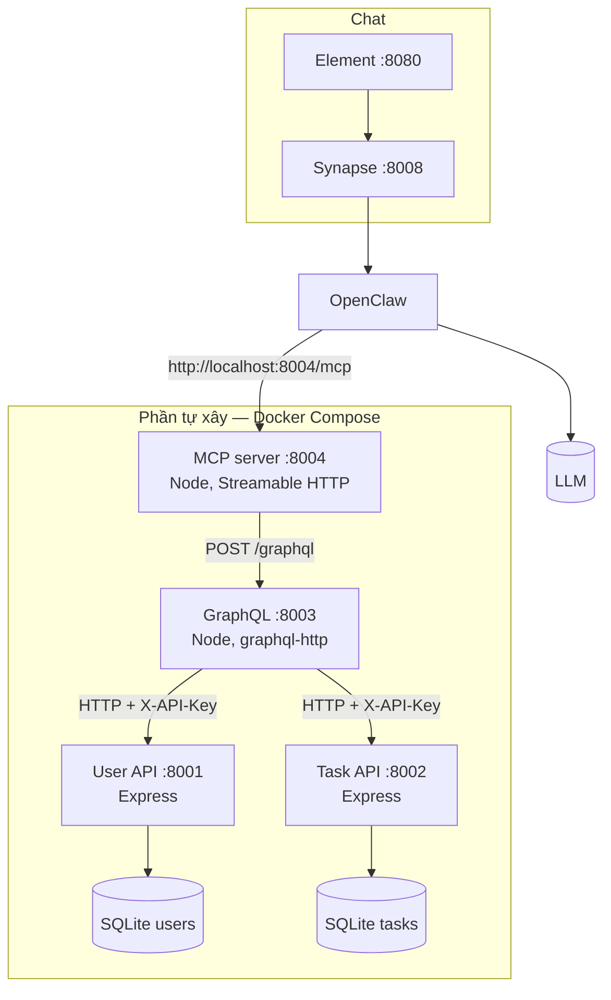
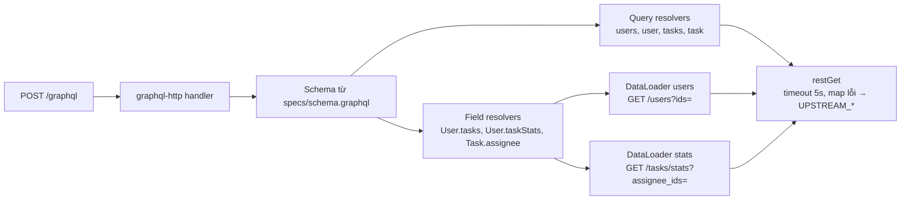
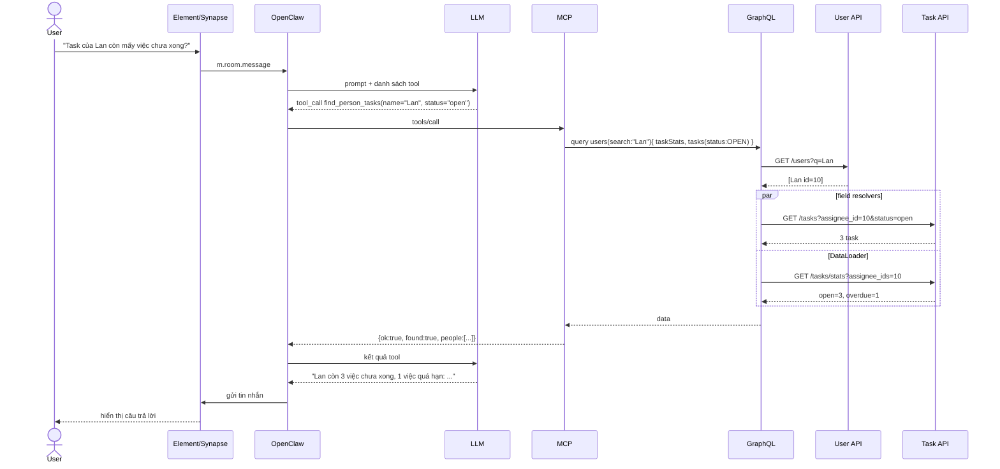
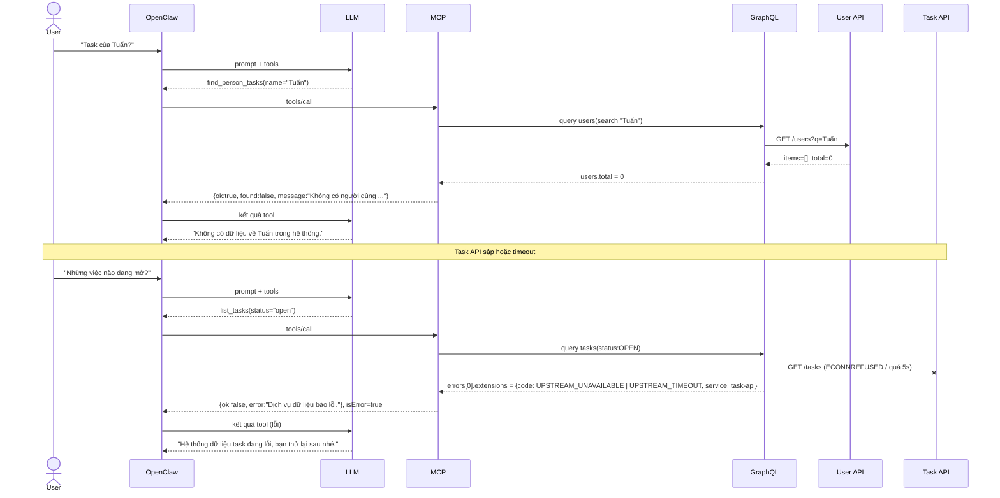
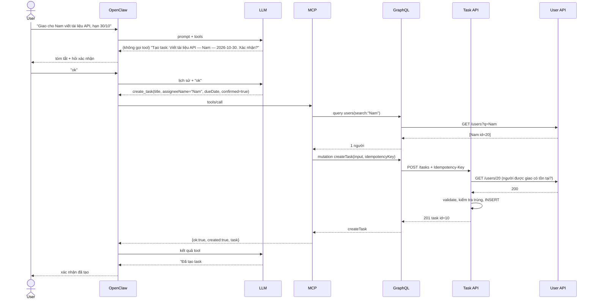
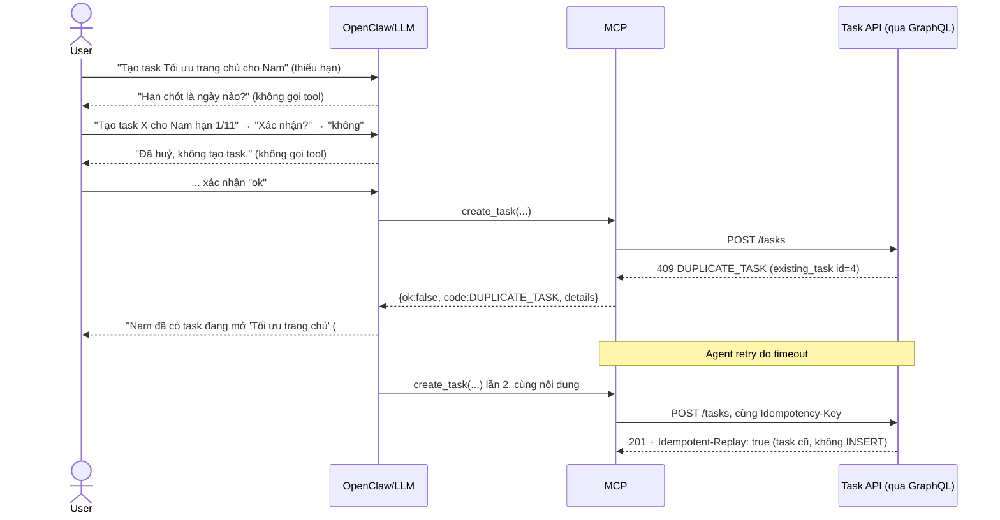

# Báo cáo Bài 1 — REST → OpenAPI → GraphQL → MCP

Diagram viết bằng Mermaid. GitHub, GitLab và VS Code tự render được, hoặc dán vào mermaid.live để xem.

## C1 — System Context

## C2 — Container

## C3 — Component (GraphQL gateway)

## Sequence 1 — "Task của Lan còn mấy việc chưa xong?" (thành công)

## Sequence 2 — Nhánh lỗi

## Kịch bản demo trong Element (chụp ảnh nộp bài)

| # | Câu hỏi | Kỳ vọng |
|---|---|---|
| 1 | Task của Lan còn mấy việc chưa xong? | 3 việc, 1 quá hạn (số lấy từ `taskStats`) |
| 2 | Những việc nào đang mở, ai làm? | Danh sách 6 task kèm tên người. Câu này cần gom cả 2 API |
| 3 | Task của Tuấn? | Không có dữ liệu, không bịa |
| 4 | Task số 999? | Không có task này |
| 5 | (`docker compose stop task-api`) Những việc nào đang mở? | Bot báo hệ thống lỗi |

---

# Bài 2 — Bot tạo dữ liệu qua chat

Luồng ghi: `User → OpenClaw → MCP create_task → GraphQL mutation createTask → REST POST /tasks → SQLite`

## Các lớp bảo vệ

| Rủi ro | Chặn ở đâu | Cách chặn |
|---|---|---|
| Bot ghi khi user chưa đồng ý | Persona + MCP | SOUL.md bắt tóm tắt và hỏi xác nhận. Tham số `confirmed` của tool chỉ nhận `true` (zod `literal(true)`) |
| Bot tự điền thông tin thiếu | Persona + MCP + REST | Persona bắt hỏi lại. Tool bắt buộc đủ 3 trường. REST trả 422 nếu thiếu hoặc sai |
| Giao nhầm người | MCP + REST | MCP tra tên: 0 người → `ASSIGNEE_NOT_FOUND`, nhiều người → `AMBIGUOUS_ASSIGNEE`. REST kiểm tra lại id qua User API |
| Tạo trùng khi agent retry | REST (`Idempotency-Key`) | MCP sinh key từ nội dung + khung 10 phút. Gửi lại cùng key thì REST trả kết quả cũ (`Idempotent-Replay: true`) |
| Tạo trùng do user nhập lại | REST | Task đang mở cùng người, trùng tiêu đề (không phân biệt hoa thường, khoảng trắng) → `409 DUPLICATE_TASK` |
| Dữ liệu sai định dạng | REST | Tiêu đề 3–200 ký tự, ngày phải có thật và không ở quá khứ → `422 VALIDATION_ERROR`, `details` chỉ rõ trường lỗi |

## Sequence — tạo thành công có xác nhận

## Sequence — nhánh lỗi

## Kịch bản demo (chụp ảnh nộp bài)

| # | Tình huống | Câu nhắn mẫu | Kết quả đúng |
|---|---|---|---|
| 1 | Tạo thành công có xác nhận | "Giao cho Nam viết tài liệu API, hạn 2026-10-30" → "ok" | Bot tóm tắt, hỏi xác nhận, rồi báo đã tạo kèm id |
| 2 | User từ chối | "Tạo task Viết test e2e cho Hoa hạn 2026-11-05" → "không" | "Đã huỷ", log MCP **không** có `create_task` |
| 3 | Thiếu thông tin | "Tạo task Review code cho Minh" | Bot hỏi hạn chót, không tự điền |
| 4a | Trùng | "Giao cho Nam việc tối ưu trang chủ hạn 2026-10-30" → "ok" | Bot báo trùng task #4 |
| 4b | Dữ liệu sai | "Tạo task Họp cho Lan hạn 2026-01-01" → "ok" | Bot báo hạn chót ở quá khứ, hỏi lại ngày |
